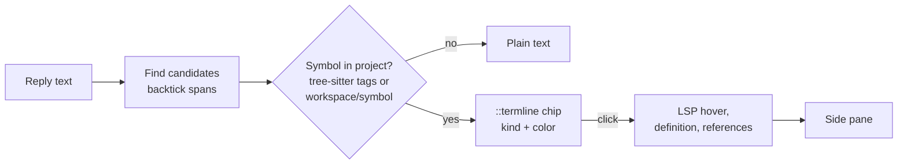

# LSP bridge and file viewer: research

Date: 2026-11-10. Hermes Agent v0.23.1, local commit `3b42157858`. Status: research only. We built nothing.

This note answers two questions:

- `lsp.symbol_chips`: can the plugin find code symbols in chat, resolve them with a Language Server Protocol (LSP) server, and color them like an IDE?

- `lsp.file_viewer`: can a plugin pane show a file with LSP features such as hover and go-to-definition?

Labels: "verified" means that we read the code or ran it. "Inferred" means that we did not run it. "A guess" means that we did not check it.

## What Hermes already has `lsp.existing`

Hermes Agent has an LSP layer at `agent/lsp/` (about 4,000 lines). It starts pyright, typescript-language-server, gopls, rust-analyzer, clangd, and about 20 other servers. It installs the servers, stops idle servers, and checks workspace trust. Verified (read `agent/lsp/`, `website/docs/user-guide/features/lsp.md`).

Today the layer gives only diagnostics after the agent writes a file. The client tells each server that it supports hover, definition, references, and documentSymbol (`agent/lsp/client.py:59-75`). No production code sends these requests. Only private methods (`_send_request`, `_get_or_spawn`) can send them. Verified (read, grep).

The desktop app already bundles CodeMirror 6 and Shiki 4.5. It has a file tree pane, a review pane, and a file preview tab. The plugin SDK does not expose any of these to plugins. Verified (read `apps/desktop/package.json`, `apps/desktop/src/app/contrib/controller.tsx:259-292`, `apps/desktop/src/sdk/index.ts`).

The catalog plugin `omh` already gives the agent `lsp_definition` and `lsp_references` tools. It calls the private LSP methods. Verified (read `plugin-catalog/omh.yaml`).

## How `lsp.symbol_chips` works

The closest prior art is GitHub Copilot Chat in VS Code. It uses only backtick spans as candidates. It checks each candidate against tree-sitter declarations in the files that the prompt already has. It keeps at most 8 candidates, and it resolves the exact definition only on click. Verified (read `inlineCodeSymbolLinkifier.ts`, `findWord.ts` in microsoft/vscode).

Other tools use an index. Aider uses tree-sitter tags. Serena calls documentSymbol on each file and keeps a cache. Cody uses a keyword index and SCIP. Verified (read source or docs).

The Python annotator in this plugin can do the match step. Use tree-sitter tags (`tree-sitter-language-pack`, `grep-ast`) as the fast index. Then use LSP only on click. Inferred.

A server needs one open file before `workspace/symbol` works. typescript-language-server returned "No Project." before `didOpen`. After one `didOpen`, it answered in 0.21 s, and hover took 0.01 s. It used 786 MB on a 216-file project. pyright returned 0 symbols even after `didOpen`, for an unknown reason. Verified (ran a JSON-RPC spike).

The plugin hook `transform_llm_output` does not get the working directory. Use `agent.runtime_cwd.resolve_agent_cwd()`, or send `host.state.cwd` from the renderer. Verified (read `agent/turn_finalizer.py:534-535`, `apps/desktop/src/sdk/index.ts:572-573`).

## How to color a symbol `lsp.symbol_color`

VS Code first uses the theme `semanticTokenColors`. If no rule matches, it maps the token type to a TextMate scope and uses the theme `tokenColors`. VS Code themes also have one color for each symbol kind (`symbolIcon.<kind>Foreground`). Verified (read the VS Code semantic highlight guide and theme color reference).

Use this order for one symbol in chat. Inferred.

1. Get `semanticTokens/range` for the definition line.

2. If the server has no semantic tokens (pyright), run Shiki on the definition line. Use the color of the symbol range.

3. If that fails, use the theme `symbolIcon.<kind>Foreground` color for the symbol kind.

4. If that fails, use a plain highlight.

Hermes themes are not VS Code themes. Chat code uses fixed GitHub Shiki themes that change only between light and dark. Thus the chip must use the same GitHub themes to match chat code. Verified (read `shiki-config.ts:9`, `themes/types.ts`).

A plugin cannot decorate inline code in chat. The only hook is `transcript.directives`. Thus a colored symbol must be a directive, as `::termline` is now. Verified (read `apps/desktop/src/lib/transcript-directives.ts:23-54`).

## Is `lsp.file_viewer` possible

Yes. Inferred. A plugin can register a pane at any time. A pane takes no arguments, so a plugin atom holds the file path. This is the same method that `$selectedTerm` uses now. Verified (read `apps/desktop/src/contrib/plugin.ts:115-193`, `contrib/types.ts:45`).

The plugin must bundle its own editor. CodeMirror 6 with `@codemirror/lsp-client` is 448 KB minified (150 KB gzip). It has no `eval`, no `new Function`, no dynamic `import()`, and no workers. Verified (ran esbuild). The plugin size limit is 16 MiB. Verified (read `runtime-loader.ts:724-745`).

Monaco does not fit. Its core is 2.7 MB minified, and it contains dynamic `import(` and `new Worker`. The admission lint refuses dynamic `import()`. Verified (ran esbuild, read `plugin_validate_desktop.py:21-58`).

`@codemirror/lsp-client` has no semantic tokens. Thus the viewer needs its own decoration extension for IDE colors. No package for this exists. Verified (read package source).

The transport is simple. The CodeMirror `Transport` interface has only send, subscribe, and unsubscribe. The Python backend can relay messages through `ctx.socket`. `ctx.socket` does nothing on OAuth remotes, so keep `ctx.rest` polling as a fallback. Inferred.

A WebSocket route needs `isolation: in_process`. With `isolation: host`, the gateway buffers plugin routes, so they cannot stream. Verified (read `web_server_dashboard.py:1015-1018`).

## Blocker `lsp.blocker`

Hermes has no public way to send hover, definition, or references. There are three paths:

| Path | Cost | Risk |
|---|---|---|
| Upstream PR: add a public `request()` to `agent.lsp` | Small change, review time | Can miss the catalog deadline |
| Call the private methods, as `omh` does | No new code | Catalog warning, breaks when Hermes changes |
| Start our own servers with multilspy | Second copy of each server, about 0.8 GB for TypeScript | We must disclose it as a long-running process |

## Catalog rules that apply `lsp.catalog_rules`

Verified (read `plugin-catalog/README.md`):

- Desktop plugins stay inside the SDK surface.

- Private imports and calls into Hermes core get warnings.

- Disclose long-running processes and reads outside plugin data.

- Get LSP binaries only from the official source, with a pinned checksum.

- Declared capabilities must match what the plugin does.

## Open items `lsp.open`

- Find why pyright returned 0 symbols from `workspace/symbol`.

- Measure rust-analyzer and gopls memory.

- Test Shiki and CodeMirror inside the Hermes renderer.

- Check if the loader refuses a bundle that only contains the text `import(`.

## Sources

- Research notes: `scratchpad/hermes-internals/notes.md`, `scratchpad/lsp-prior-art/notes.md` (session scratchpad, not in git).

- Hermes LSP docs: https://github.com/NousResearch/hermes-agent/tree/main/agent/lsp

- `@codemirror/lsp-client`: https://www.npmjs.com/package/@codemirror/lsp-client

- Shiki: https://shiki.style

- multilspy: https://github.com/microsoft/multilspy

- Serena: https://github.com/oraios/serena

- VS Code semantic highlight guide: https://code.visualstudio.com/api/language-extensions/semantic-highlight-guide
