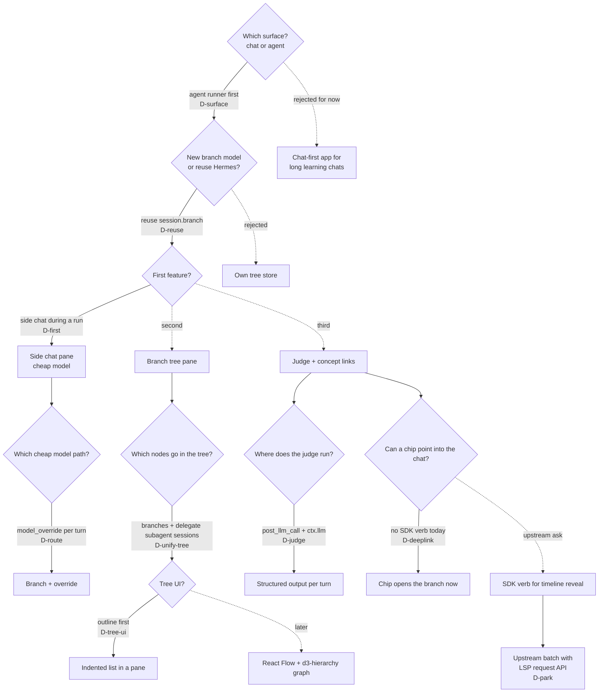

# Chat trees, side questions, and concept links: research and decisions

Date: 2026-11-11. Hermes Agent v0.23.1, local commit `3b42157858`. Status: research only. We built nothing.

This note records the directions that Claude took on its own, so that Rohan can track them. Each decision has one row in [decisions.tsv](decisions.tsv). The decision tree below shows the path.

Labels: "verified" means that we read the source or ran a command. "Secondary" means that the fact came from a search summary or press. "Inferred" means that we did not check it.

## The problem `chat_tree.problem`

An LLM brings in a new concept in the middle of an answer. A question about that concept in the same chat pulls the chat off its topic. The idea has four parts:

- `chat_tree.fork`: the user forks a branch for a side question. The main chat stays on topic.

- `chat_tree.route`: a cheaper model answers the side question.

- `chat_tree.tree_view`: each branch and node has a label. A tree view lets the user move between branches.

- `chat_tree.judge`: a small judge model marks where a concept gets defined. Concept-links chips point to that place.

## Decision tree `chat_tree.decisions`

## Which surface people use `chat_tree.usage`

| Metric | Value | Date | Label |
|---|---|---|---|
| ChatGPT weekly users | 900M | 2026-02 | Secondary |
| ChatGPT non-work share | 53% to more than 70% | 2022 to 2025-07 | Verified (NBER w34255) |
| Codex weekly users | 0.6M to 5M | 2026-01 to 2026-06 | Secondary |
| Agent share of OpenRouter tokens | 8% to 76% | 2025-10 to 2026-10 | Verified (openrouter.ai/data) |
| Median human prompts per session | Claude Code 1, chat 13 | 2026-04 to 2026-06 | Verified (Anthropic Economic Index) |
| hermes-agent stars | 262,546 | 2026-11-11 | Verified (`gh api`) |
| hermes-agent PyPI downloads per month | 555k to about 163k | 2026-07 to 2026-10 | Secondary |

Chat has the most users. Agents have most tokens and most growth in developer and enterprise use. Hermes is an agent product, and Desktop is a control screen for a running agent. Inferred.

## What Hermes already has `chat_tree.existing`

All facts in this section are verified (read source). Paths are relative to the hermes-agent repo.

- A branch is a new session. It has `parent_session_id` and copies of the rows up to `through_message_id` (`hermes_state_mutation_branch.py:52-104`). Both sessions must be idle (`:58`).

- Desktop has a "Branch in new chat" button on each assistant message. The sidebar nests branches under their parent (`apps/desktop/src/lib/session-branch-tree.ts`). There is no tree view and no fork marker in the transcript.

- `/btw` answers a side question from a snapshot of the transcript. It does not write to the transcript. It can use `auxiliary.side_question.provider/model` (`agent/side_question.py:8`). Desktop does not show it. Feature request #75898 asks for this as a side chat.

- A plugin can call gateway methods through `host.request`: `session.branch`, `session.transcript`, `session.title`, and `prompt.submit` with `model_override` (`apps/desktop/src/sdk/index.ts:1503-1520`). We did not run these from a plugin.

- A plugin can call a cheap model with host credentials through `ctx.llm.complete_structured` after `ctx.register_auxiliary_task`. The hook `post_llm_call` gets the history and the reply.

- No SDK verb can scroll to a message. Routes take no parameters. The internal event `hermes:timeline-reveal` exists, but a plugin must reach into app markup to use it, and the lint refuses that.

## Prior art `chat_tree.prior_art`

| Product or paper | Model | Tree UI | Auto labels | Lesson |
|---|---|---|---|---|
| ChatGPT "Branch in new chat" | Linked threads | None | No | The user loses the link between chats |
| Claude Code `/btw` | Side call, not saved | Side panel | No | Asks while the agent works. No tools |
| LibreChat fork | Linked threads | None | No | Context modes worth copying |
| Loom (socketteer) | Tree in a file | Tree, hotkeys | No | Stale since 2024-06 |
| CanvasConvo (arXiv 2605.15848) | Message nodes | Chat plus a linked canvas | Yes | Chat stays primary. Trees stay shallow |
| ContextBranch | Branches | n/a | n/a | Branching cut context 58% on far tangents |

The research found no product with concept-link chips that point into a chat. The research found no product that sends side questions to a cheaper model on purpose.

## Libraries `chat_tree.libraries`

All rows are verified (esbuild bundle, grep for `eval`, `new Function`, `Worker`, dynamic `import`).

| Library | Gzip size | Problem | Use |
|---|---|---|---|
| d3-hierarchy | 2.4 KB | None | Tree layout |
| react-arborist | 31 KB | None | Outline view |
| @xyflow/react | 62 KB plus CSS | None | Graph view, later |
| elkjs | 452 KB | GPL or EPL license, size | Do not use |

## Reconcile with the second research `chat_tree.reconcile`

A second agent did the same research on 2026-11-11 and sent it by email. Its raw notes are on another computer, so we could not check its sources. Its numbers have the label "not checked" below.

| Topic | This note | Second research | Result |
|---|---|---|---|
| Agent share of OpenRouter tokens | 8% to 76% | 8% to 76% | Agree |
| ChatGPT weekly users | 900M (2026-02, secondary) | About 1.2B (not checked) | Both say chat has the most users. The date of the 1.2B figure is not known |
| Spend | Coding is $4.0B of $7.3B departmental spend (Menlo, secondary) | Coding tools $34.0B, enterprise chatbots $25.0B (Menlo, not checked) | Different Menlo splits. Both put coding first |
| Developer use | Not measured | Agents 66%, chatbots 63% (Stack Overflow). Agent use 90% weekly (JetBrains). Not checked | New data. It supports a tree for developers that holds both chats and agent runs |
| First audience | Agent runners in Hermes Desktop | Developers who use both chat and agents | Compatible |
| Tree contents | Chat branches only | Chat threads and agent transcripts as one tree | Adopt. See `D-unify-tree` |
| Concept links | Open the branch. No SDK verb scrolls to a message | Point at the node where the term was defined | Agree on the target. The node is a session in the tree pane until Hermes gets a reveal verb |
| Rejected paths | Chat-first app | Consumer chat only, agents only, wait a year | Agree |

The merge changes one decision. The tree pane shows branch sessions and delegate subagent sessions in one tree. Hermes stores both as sessions with a parent. Branches use `_branched_from`, and subagents use `_delegate_from` (`hermes_state_delegate_children.py:13-28`). Verified (read). The order of features does not change.

## Next steps `chat_tree.next`

1. Spike `host.request('session.branch')` and `prompt.submit` with `model_override` from a plugin pane.

2. Build the side chat pane. It forks from the last message and uses a cheap model.

3. Add the outline tree pane from `host.listPersistedSessions`. Show branch sessions and delegate subagent sessions.

4. Add the judge on `post_llm_call`. Store marks in `ctx.state`, keyed by session id and row id.

5. Ask upstream for a public "reveal message" SDK verb. Send it with the LSP `request()` API in one batch.

## Risks `chat_tree.risks`

- Hermes Desktop has about 8 open bugs in branching, such as a cut at the wrong message. Our feature depends on that code.

- Branching needs an idle session. Thus a real fork cannot start in the middle of an agent run. The side chat must use `/btw` style snapshots until the run ends.

- PyPI downloads of hermes-agent fall since 2026-07. Secondary.

## Sources

- Research notes (session scratchpad, not in git): `scratchpad/branching-internals/notes.md`, `scratchpad/chat-tree-prior-art/notes.md`, `scratchpad/usage-surface/notes.md`.

- NBER, "How People Use ChatGPT": https://www.nber.org/papers/w34255

- Anthropic Economic Index, June 2026: https://www.anthropic.com/research/economic-index-june-2026-report

- OpenRouter data, October 2026: https://openrouter.ai/data/october-2026

- CanvasConvo: https://arxiv.org/abs/2605.15848

- Hermes feature request for side chats: https://github.com/NousResearch/hermes-agent/issues/75898
