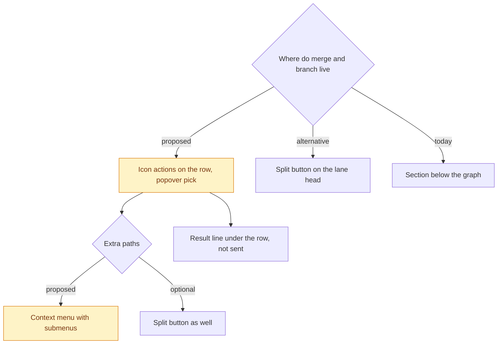

# Merge and branch UI in the tree pane: a proposal from VS Code patterns

Date: 2026-11-12. Status: proposal, nothing built. Rohan picks the options in `ui.choices`.

## What is wrong now `ui.problems`

The screenshot of 2026-11-12 shows the merge section below the graph:

```
Merge Imported from Claude Code: (imported conversation begins with an assistant reply) #3
into: [mported conversation beg] (imported conversation be
[ Merge as-is ]  [ Digest ]
```

| Problem | Why it hurts |
|---|---|
| The heading is the raw chat title, long and bold | It is noise. It says nothing about the action. |
| The target chips look like text inputs and are cut mid-word on both sides | The user cannot tell the targets apart or see that they are choices. |
| Two buttons have the same weight | There is no default. "Digest" does not say what it makes or where it goes. |
| The section sits below the graph, far from the lane it acts on | The user must connect the section to a lane by eye. |
| Nothing says what happens | The user cannot see the size, the fit, or that the text is staged and not sent. |

## What VS Code does `ui.vscode`

Verified (read the VS Code UX guidelines on 2026-11-12):

- Tree views: "Add no more than three actions to an item." "Don't use tree items as buttons that fire Commands on click." Use product icons to tell item types apart. ([views](https://code.visualstudio.com/api/ux-guidelines/views))

- Welcome views: use buttons only for primary actions, and prefer links. ([views](https://code.visualstudio.com/api/ux-guidelines/views))

- Quick Picks: use them to get input or to pick from a list. Use steps for related selections, and show the step in the title ("1/2"). Use the description for the current item and the detail for brief context. Group items with labeled separators. ([quick picks](https://code.visualstudio.com/api/ux-guidelines/quick-picks))

- Context menus: group similar actions, and put large groups in a submenu. ([context menus](https://code.visualstudio.com/api/ux-guidelines/context-menus))

From memory, not checked tonight:

- The Source Control view has one primary button with a dropdown arrow: "Commit", and the arrow holds "Commit & Push" and "Amend". The default is one click. The other choices are one more click.

- The merge editor puts small text actions on each conflict: "Accept Incoming", "Accept Current", "Accept Combination".

- The Source Control graph shows a rich tooltip on hover and icon actions at the end of a row.

## What the Hermes SDK gives us `ui.sdk`

Verified (read `apps/desktop/src/sdk/index.ts`): `Codicon`, `Tooltip` and `Tip`, `Popover`, `DropdownMenu` (no submenu), `ContextMenu` (with submenu), `Badge`, `Kbd`, `Input`, `Separator`, and `ModelCatalogMenu`. Each piece below uses only these.

## The proposal `ui.proposal`

### Actions on the row `ui.row_actions`

Each node row shows up to three icon actions when the pointer is on it or it has focus. The row itself only selects the node.

```
●  Explain virtualenv   haiku  side        [⑂] [⇅] [↗]
                                            │    │    └ Open in a tab
                                            │    └ Merge into…   (codicon git-merge)
                                            └ Branch here…       (codicon repo-forked)
```

- Merge shows only on a row of a chat that has a parent.

- Each icon has a tooltip with its name and its keyboard key.

### Merge as a two-step pick `ui.merge_pick`

Merge opens a popover at the row, in the style of a Quick Pick.

```
Merge "Explain virtualenv"                     1/2  Where
── Parent ──────────────────────────────────────────────
›  Publish a Python package to PyPI              default
── Older ancestors ─────────────────────────────────────
   Project setup
```

```
Merge "Explain virtualenv" into "Publish a Python…"   2/2  How
›  As-is     4 exchanges · about 3.1k tokens · fits (36k free)
   Digest    a summary written by the digest model · about 300 tokens
```

- Enter on step 1 picks the parent, so the default is two keys: Enter, Enter.

- The lane of the hovered target lights up in the graph while the pick is open.

- A mode that does not fit is shown greyed, with the numbers in its detail line. It cannot be picked.

- Labels use the chat question, cut to one line. The full title is in the tooltip.

### The result in place `ui.result`

After a merge, one line shows under the row:

```
✓ Staged in the composer of "Publish a Python…". Not sent.   Open
```

A failure shows in the same place, in the error colour, with a Dismiss link. It stays until the user dismisses it.

### A split button for the default `ui.split_button`

The lane head of the open chat can also carry a split button, as the Source Control view does:

```
[ ⇅ Merge into parent | ▾ ]
                        └ As-is into parent / Digest into parent / Other target…
```

### A context menu for everything `ui.context_menu`

A right click on a row opens a context menu with groups and submenus:

```
Open                    ↵
Open in a tab
─────────────
Branch here…
Merge into           ▸  Publish a Python…  ▸  As-is
                        Project setup      ▸  Digest
─────────────
Copy question
```

### Branch here with the same pattern `ui.branch_pick`

Branch here opens a popover at the row: a one-line question input, the model picker of Hermes (`ModelCatalogMenu`), and Enter to send. The form below the graph goes away.

## Choices for Rohan `ui.choices`


