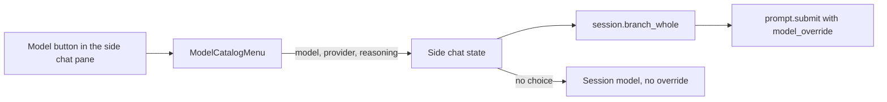

# Plugin CSS and the side chat model picker: findings

Date: 2026-11-12. Hermes Agent v0.23.1, installed at `~/.hermes/hermes-agent`. Each claim was checked by reading that source or the shipped app files.

## Tailwind classes in a desktop plugin `findings.css`

Hermes Desktop runs Tailwind once, when the app is built. Tailwind writes CSS only for the class names it finds in the app source. A desktop plugin loads later from `~/.hermes/desktop-plugins`, so its class names are never scanned. `apps/desktop/src/styles.css` has no `@source` line for the plugin folder.

Thus a class works in a plugin only if the app uses the same class. Otherwise the class has no CSS rule and does nothing.

Classes checked in `apps/desktop/dist/assets/main-D01CRUNp.css`:

| Class | In the shipped CSS |
|---|---|
| `flex`, `gap-2`, `text-sm`, `truncate`, `border-l-2` | present |
| `decoration-dotted` | absent |
| `bg-blue-500`, `text-blue-400`, `stroke-blue-500` | absent |
| `w-[58px]`, `h-[26px]` | absent |

Rules for plugin code:

- Use a Tailwind class only when the shipped CSS contains it. To check, search the CSS file for `.<class>`.

- Use inline styles or SVG attributes for exact sizes and colours.

- A render harness must load the real `main-*.css` of Hermes, not the Tailwind CDN. The CDN makes every class, so a screenshot would show a missing class as if it works.

## The side chat model picker `findings.model_picker`

The user picks the side chat model from the model list of Hermes. The entry does not assume a cheap model.

- The SDK exports `ModelCatalogMenu` (`apps/desktop/src/sdk/index.ts:1657`). It is the searchable picker that the chat composer uses, grouped by provider.

- A `ModelMenuController` (`apps/desktop/src/app/shell/model-catalog-menu.tsx:156`) decides what a choice means. Its `select(model, provider)` gets the chosen row.

- The built-in kanban plugin uses the same picker for a model per task (`apps/desktop/src/plugins/kanban/model-override.tsx`). It wraps the menu in `DropdownMenu`, `DropdownMenuTrigger`, and `DropdownMenuContent`, which the SDK also exports. Its `presetFor` returns `{}`, so it never changes the global presets.

`prompt.submit` takes a one-turn `model_override` with the keys `model`, `provider`, and `reasoning` (`gateway/session_cli_turn.py:40-53`, `tui_gateway/contracts/canonical_sessions.py:234-239`).

- `reasoning` applies to that turn only. It does not change the reasoning policy of the session (`gateway/session_cli_turn.py:201-208`).

- Any other key makes the call fail with `invalid_params`. Do not send `fast` or `serviceTier`.

- With no choice, send no override. The side chat then uses the model of the session.

Correction: an earlier note said that `prompt.submit` might drop `reasoning`. That note read `tui_gateway/agent_factory.py:548`, which is the override path for a whole session. Another Claude session found the one-turn path above.
