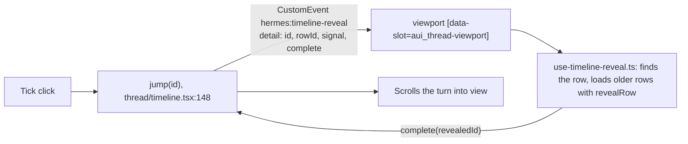

# Scroll to a message from the tree: findings

Date: 2026-11-12. Hermes Agent v0.23.1. Each claim was checked by reading the installed source.

The chat timeline rail (the tick marks with a preview tooltip) scrolls to a message through a DOM event, not through the SDK. The SDK has no scroll API.

Facts:

- The event name is `hermes:timeline-reveal` (`thread/timeline-data.ts:26`). The detail is `{ id, rowId, signal, complete }`.

- The listener resolves `rowId`, or an id of the form `history:<rowId>`. It loads older rows when the row is not on screen (`use-timeline-reveal.ts:54-75`).

- The page message id is `timestamp-index-role`, so it is not stable. The stable key is `rowId`, the database row id (`lib/chat-messages/hydration.ts:563`).

- `session.history` rows carry `row_id` (`tui_gateway/session_history.py:359`).

- The main chat sits in `[data-session-anchor="workspace"]`. A chat in a tile sits in `[data-session-anchor="session-tile:<storedId>"]` (`app/chat/index.tsx:548`).

Risk, accepted by Rohan on 2026-11-12:

- Catalog rule 8 forbids reaching into app markup. `hermes plugins validate` refuses `document.querySelector('[data-slot=...]')` with the selector written in place. Any other form gets a review warning.

- The event name and the markup are not public. A Hermes update can break them without notice. The plugin then falls back to opening the chat.
